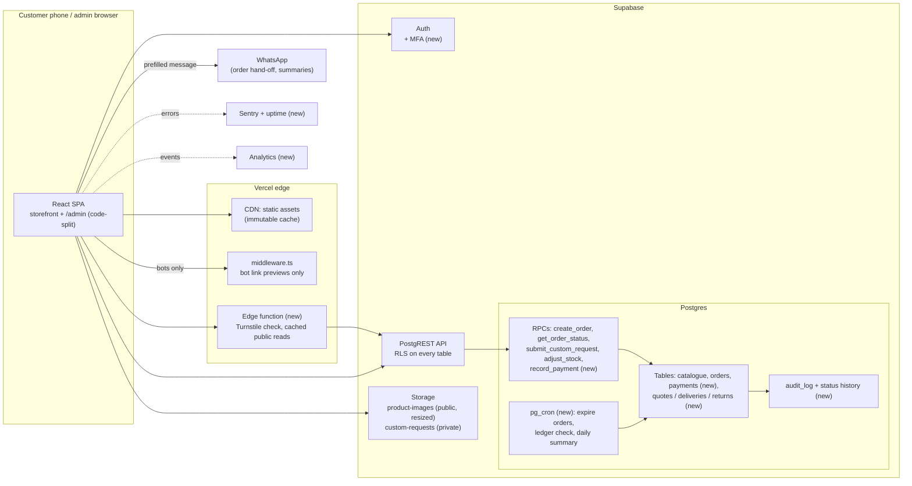

# Production readiness audit

Date: 16 November 2026. Scope: the 14 migrations in `supabase/migrations`, the data layer in `src/lib/api`, `middleware.ts`, `vercel.json`, and the live Supabase project (security and performance advisors, row counts). This is a code and configuration review, not a penetration test, and it assumes the current business model: orders are captured on the site and paid offline.

## Summary

The core is sound. The parts that usually go wrong in a first e-commerce build are done properly here:

- **Prices and totals** are recalculated in the database (`create_order`). The client's numbers are ignored.
- **Overselling is prevented.** Stock is taken with a conditional update (`stock_quantity >= qty`) inside one transaction, so two buyers cannot both get the last item, and any failure rolls back the whole order.
- **Order lines are snapshots** (name, variant label, SKU, price), so later product edits never change past orders.
- **Stock has a ledger** (`inventory_movements`), and cancelling an order restores stock to the same variant through a trigger. A cancelled order cannot be reopened.
- **RLS is on every table.** Anonymous users reach orders and custom requests only through rate-limited RPCs. The service role key is not in the client.
- **Abuse limits:**
  - Per-IP, per-phone and global rate limits on ordering, tracking and custom requests, plus a lockout for guessing the phone number on a known order.
  - Upload limits with fixed paths, MIME and size checks on the buckets.
  - URL columns that reject `javascript:` links.
- **Browser hardening:**
  - A strict Content-Security-Policy.
  - HSTS and frame-ancestors none.
  - No-store and noindex on `/admin`.
- **No raw HTML rendering:** there is no `dangerouslySetInnerHTML` anywhere in `src`.

The weaknesses are mostly what a business needs **once real money and staff are involved**:

- There is no payment ledger and no audit trail.
- Staff can edit stock and totals directly, which bypasses the stock functions.
- Unconfirmed orders hold stock forever.
- Admin sign-in has no second factor.
- Several furniture-specific workflows (quotes, delivery scheduling, installation, returns) are only single fields or are missing.

No finding is Critical: nothing lets an outsider read private data or change prices.

## Scores

| Area | Score | Why |
|---|---|---|
| Architecture | 7.5/10 | Clean split: one data layer, business rules in Postgres, a static SPA on a CDN. Missing: background jobs, monitoring, analytics. |
| Database | 7.5/10 | Good constraints, snapshots, ledger and indexes. Missing: payments, audit, returns, quotes, deliveries, structured dimensions. |
| Backend | 7/10 | Atomic order RPC with clear error codes. Admin writes go straight to tables, so integrity rests on the UI being well behaved. |
| Security | 8/10 | Strong for anonymous visitors. Weaker inside: no MFA, leaked-password check off, a broad staff role, no audit log. |
| Scalability | 6.5/10 | Comfortable to a few hundred products. The whole catalogue is loaded into the browser and filtered there, which has a hard ceiling. |

---

## 1. Database

### Already correct
- Foreign keys are indexed (including the ones added later) and use deliberate delete rules: `restrict` on products and variants with order history, `cascade` on images, `set null` on ledger rows.
- There are check constraints on prices, stock (≥ 0), phone format, slugs, two-level category depth, and `line_total = unit_price × quantity`.
- Variant option values are checked against the product's options, and a variant image must belong to the same product.
- Soft delete uses `is_active` on products, variants, categories, zones and slides. Variants with order history are deactivated, not deleted.

### D1. No payment ledger — High
**Problem.** Payment is three editable fields on `orders` (`payment_status`, `payment_method`, `deposit_amount`/`balance_due`), and the admin UI sends `balance_due` itself (`updateOrder` in `src/lib/api/admin/sales.ts`). Nothing records how much was received, when, by what reference (for example an M-Pesa code), or by whom.
**Impact.** You can't reconcile against M-Pesa or bank statements, settle a dispute ("I paid the deposit"), or detect a mistaken or dishonest entry. A part-payment beyond the deposit can't be recorded at all.
**Fix.** Add a payments table and derive the order's balance from it in the database:

```sql
create type public.payment_kind as enum ('deposit', 'payment', 'refund');

create table public.payments (
  id           uuid primary key default gen_random_uuid(),
  order_id     uuid not null references public.orders (id) on delete restrict,
  kind         public.payment_kind not null,
  amount       numeric(12,2) not null check (amount > 0),
  method       text not null,              -- 'M-Pesa Paybill', 'Bank transfer', 'Cash'
  reference    text,                       -- M-Pesa code / bank ref
  received_at  timestamptz not null default now(),
  recorded_by  uuid not null default auth.uid() references auth.users (id),
  note         text,
  created_at   timestamptz not null default now(),
  unique (method, reference)               -- the same M-Pesa code cannot be entered twice
);
create index payments_order_idx on public.payments (order_id);

-- Recompute balance and payment_status from the ledger (never typed by hand).
create function public.orders_apply_payments() returns trigger
language plpgsql security definer set search_path = '' as $$
declare v_paid numeric(12,2); v_total numeric(12,2); v_dep numeric(12,2);
begin
  select coalesce(sum(case when kind = 'refund' then -amount else amount end), 0)
    into v_paid from public.payments where order_id = coalesce(new.order_id, old.order_id);
  select total, deposit_amount into v_total, v_dep from public.orders where id = coalesce(new.order_id, old.order_id);
  update public.orders set
    balance_due    = greatest(v_total - v_paid, 0),
    payment_status = case when v_paid <= 0 then 'unpaid'
                          when v_paid >= v_total then 'paid'
                          when v_paid >= v_dep then 'deposit_paid'
                          else 'unpaid' end
  where id = coalesce(new.order_id, old.order_id);
  return null;
end $$;
create trigger payments_apply after insert or update or delete on public.payments
  for each row execute function public.orders_apply_payments();
```

Then remove `payment_status` and `balance_due` from `OrderPatch` and make payments append-only for staff: no update or delete, and a mistake is corrected with a refund row.

### D2. No audit trail or order status history — High
**Problem.** There is no record of who changed an order's status, payment, delivery date or notes, a product's price, or a setting. The tracking page can only show the current status, not a timeline.
**Impact.** With more than one staff member you can't answer "who marked this delivered?" or "when did the price change?". Customer disputes and internal fraud become unresolvable.
**Fix.** Add one generic audit table filled by triggers, plus a small status-history table the tracking page can read through the existing RPC:

```sql
create table private.audit_log (
  id         bigint generated always as identity primary key,
  table_name text not null,
  row_id     uuid not null,
  action     text not null,                 -- INSERT / UPDATE / DELETE
  changed    jsonb,                          -- only the columns that changed: {col: [old, new]}
  actor      uuid default auth.uid(),
  at         timestamptz not null default now()
);
create index audit_log_row_idx on private.audit_log (table_name, row_id, at desc);

create table public.order_status_history (
  id         bigint generated always as identity primary key,
  order_id   uuid not null references public.orders (id) on delete cascade,
  status     public.order_status not null,
  changed_by uuid default auth.uid(),
  changed_at timestamptz not null default now(),
  note       text
);
create index order_status_history_order_idx on public.order_status_history (order_id, changed_at);
```

Attach an `AFTER UPDATE` trigger to `orders`, `products`, `product_variants`, `settings`, `delivery_zones` and `admin_users` that writes the changed columns. Show the order's history on the admin order page, and the dated steps on Track order.

### D3. Staff can bypass the stock ledger and order totals — High (fixed 16 Nov 2026)
> **Fixed** in `20261116064158_protect_stock_and_orders.sql`:
> - Guard triggers reject stock changes and changes to an order's number, customer, zone, subtotal, fee or total from API callers. A column-level `revoke` would not work here, because Supabase grants table-wide UPDATE.
> - Direct inserts into the stock log, orders and order lines are revoked.
> - Converting a custom request now runs as a checked SECURITY DEFINER function.
> - New check constraints keep the deposit and balance at or below the total.
>
> Tested in a rolled-back transaction: every bypass is refused, and ordering, Adjust/Restock, editing an order's status, payment, deposit, notes and date, cancelling, and converting a custom request all still work.

**Problem.** The UI correctly uses `adjust_stock`, but the RLS policies (`products: admin all`, `product_variants: admin all`, `orders: admin update`, `order_items: admin update`, `inventory_movements: admin insert`) let any signed-in admin call the REST API directly. They could:
- set `stock_quantity` with no movement logged;
- insert a movement without changing stock;
- change `subtotal`, `total` or order lines after the order was placed.

**Impact.** Stock and the ledger can silently disagree, and totals can be changed after the fact. It only takes one staff member using the browser console.
**Fix (as applied).** Only the database functions may change these columns. A trigger checks the caller's role, because those functions run as the table owner:

```sql
create function public.guard_stock_quantity() returns trigger language plpgsql set search_path = '' as $$
begin
  if current_user in ('anon', 'authenticated')
     and tg_op = 'UPDATE' and new.stock_quantity is distinct from old.stock_quantity then
    raise exception using errcode = 'P0001', message = 'STOCK_LOCKED';
  end if;
  return new;
end $$;
revoke insert, update, delete on public.inventory_movements from anon, authenticated;
revoke insert, update, delete on public.order_items from anon, authenticated;
```

Still to do (Low): a nightly check that each item's stock equals the sum of its movements, with any difference shown on the dashboard.

### D4. Owners can hard-delete orders — Medium
`admin_delete_order` removes the order and its lines. The ledger keeps a note, but the sale disappears from revenue, customer history and best sellers. That's fine for test or spam orders, but risky once you trade.
**Fix.** Keep deletion only for orders that are `cancelled` and have no payments. For everything else, cancel and keep the record, or add `archived_at` and hide archived orders from the default views.

### D5. Dimensions are free text — Medium (furniture-specific)
`products.dimensions` is one text field, and variants (2-seater vs 3-seater) can't have their own size. You can't filter "sofas under 220 cm", show "will it fit", or work out delivery size.
**Fix.**

```sql
alter table public.products
  add column width_cm  numeric(6,1), add column depth_cm numeric(6,1),
  add column height_cm numeric(6,1), add column weight_kg numeric(6,1),
  add column seat_height_cm numeric(5,1);
alter table public.product_variants
  add column width_cm numeric(6,1), add column depth_cm numeric(6,1),
  add column height_cm numeric(6,1), add column weight_kg numeric(6,1);  -- null = use product's
```

Keep the text field for notes. Add a width filter to the shop, and show the selected variant's size on the product page.

### D6. Missing tables for later workflows — Medium
These are covered in section 7: quotes and quote items, deliveries, returns, and an installation service.

### D7. Tax fields — Medium (check with your accountant)
Orders have no VAT breakdown, and products have no tax rate. If the business is or becomes VAT-registered, invoices need VAT shown and may need to go through KRA's electronic invoicing (eTIMS). Add `tax_rate` on products and `tax_amount` on orders and order items now, while there are no orders, so the history stays consistent.

### D8. Minor
- **Customer identity is the phone number.** An order placed with someone else's phone attaches to that customer's history. Since the hardening migration it no longer overwrites their stored details. *Low.* A WhatsApp-verified phone, or an "unverified" flag that the admin clears, would remove the remaining ambiguity.
- **Unused indexes** (7) show up only because there are no orders yet. Keep them.
- **No cost price** on products or variants, so margin and stock-value reports aren't possible. *Low.* Add `cost_price` and keep it out of the public views.

---

## 2. Backend

### Already correct
- **One data layer** (`src/lib/api`) and **business rules in Postgres** (ordering, stock, cancel, best sellers, deletes). UI components don't compute prices.
- **Stable error codes** (`OUT_OF_STOCK`, `VARIANT_REQUIRED`, `RATE_LIMITED`…) with JSON details, mapped to friendly messages.
- **Admin RPCs check `is_admin()`/`is_owner()`** up front, and `admin_set_sort_order` uses an allow-list of tables.
- **The bot-only `middleware.ts`** is import-free and checked at build time (`scripts/check-middleware.mjs`).

### B1. Admin accounts have no second factor — High
Every customer record, order and price sits behind one email and password, and leaked-password protection is off (Supabase advisor warning).
**Fix.**
- Turn on leaked-password protection: Supabase → Authentication → Settings.
- Enable TOTP MFA.
- Make `is_admin()` require `aal2`:

```sql
create or replace function public.is_admin() returns boolean
language sql stable security definer set search_path = '' as $$
  select exists (select 1 from public.admin_users where user_id = auth.uid())
     and coalesce(auth.jwt() ->> 'aal', 'aal1') = 'aal2';
$$;
```

Add an enrol/verify step to the admin sign-in (`supabase.auth.mfa.enroll`, `challenge`, `verify`).

### B2. Unconfirmed orders hold stock forever — High (fixed 16 Nov 2026)
> **Fixed** in `20261116064159_expire_pending_orders.sql`:
> - A pg_cron job runs `private.expire_pending_orders()` every 15 minutes. It cancels orders that are still pending and unpaid after the hold time, which defaults to 48 hours and is set by the owner in Settings ("Hold unconfirmed orders for", 0 = off). The cancel trigger returns the stock.
> - The confirmation page tells the customer about the hold.
> - The admin order page shows when a pending order will be cancelled.
>
> Tested: a 49-hour-old pending order is cancelled with its stock restored. Confirmed and recent orders are left alone, and a hold of 0 turns it off.

`create_order` takes stock immediately, and only a manual cancel gives it back. Rate limits cap a single attacker at 10 orders per IP per hour, but a rotating attacker, or just customers who never send the WhatsApp message, can leave popular variants showing "Out of stock" indefinitely.
**Fix.** Add a scheduled job (pg_cron is available on Supabase) that cancels stale pending, unpaid orders. The existing cancel trigger already restores stock and logs it:

```sql
select cron.schedule('expire-pending-orders', '*/30 * * * *', $$
  update public.orders
     set status = 'cancelled',
         internal_notes = coalesce(internal_notes || E'\n', '') || 'Auto-cancelled: not confirmed within 48 hours'
   where status = 'pending' and payment_status = 'unpaid'
     and created_at < now() - interval '48 hours';
$$);
```

Make the window a setting, show "Expires in N hours" on pending orders in the admin, and say on the confirmation page that the order is held for 48 hours.

### B3. The global order cap can lock out real customers — Medium
`order_all` allows 120 orders per hour across the whole site. An attacker who rotates IPs can use that up and block genuine buyers for the rest of the hour.
**Fix.**
- Raise the global cap and rely on the per-IP and per-phone limits.
- Add a bot check on checkout. Cloudflare Turnstile, verified in a small Edge Function or Vercel function before the RPC, is invisible to most users.
- Alert the owner when the global bucket passes 50% (see B5).

### B4. Locking order in `create_order` can deadlock — Low
Variants are decremented in cart order. Two simultaneous orders containing the same two variants in opposite order can deadlock; Postgres then aborts one, and that customer sees a generic error.
**Fix.** Loop over the items sorted by `(variant_id, product_id)`. On the client, retry once on SQLSTATE `40P01`.

### B5. No error monitoring or alerting — Medium
No client error reporting exists (no Sentry or similar), and Supabase keeps a short window of logs. A broken checkout would only be noticed when a customer complains.
**Fix.**
- Add Sentry, or a free alternative, to the storefront and admin, with the `release` set to the commit SHA.
- Monitor the home, product and checkout pages with an uptime check.
- Send a daily email or WhatsApp summary from the database: new orders, failures (`RATE_LIMITED` counts), and stock mismatches from D3.

### B6. Staff role is broad — Medium
`staff` can read and export every customer and edit every order and product. Only settings, deletes and team management are owner-only.
**Fix.** Keep two roles for now, and make these owner-only:
- customer CSV export;
- price changes, via the audit log (D2) or a check;
- refunds, via the payment ledger (D1).

Add a `delivery` role later that can see only orders that are out for delivery.

### B7. Input validation
- **Server side** is good: there are length caps, phone normalisation, quantity 1–99, at most 50 lines, and date checks.
- **Admin forms** depend on table constraints. That's acceptable, but give admin-side free text (product descriptions, guide bodies) length caps in the database too, so a paste of a huge document can't bloat rows.

---

## 3. Inventory

| Check | Status |
|---|---|
| Stock per product or variant | Done |
| Adjustments with reason and note, logged | Done (`adjust_stock`, but see D3) |
| Movement history | Done (`inventory_movements`, shown per row in the admin) |
| Low-stock alerts | On the dashboard. Not pushed: add a daily message when a variant crosses its threshold (B5) |
| Overselling prevention | Done: conditional update in one transaction |
| Concurrent purchases | Safe. Rare deadlock covered in B4 |
| Stock held by abandoned orders | Missing: B2 |
| Ledger cannot drift | Missing: D3 |
| Made-to-order | Correctly skips stock and requires a deposit |
| Stocktake (count and reconcile) | Missing. *Low*: a "set counted quantity" action that logs the difference as an `adjustment` |

---

## 4. Security

| Area | Finding | Severity |
|---|---|---|
| SQL injection | Postgres functions use parameters; dynamic SQL only via `format('%I')` with a table allow-list. No string-built SQL in the client (PostgREST). | None found |
| XSS | React escapes output; no `dangerouslySetInnerHTML`; URL columns restricted to `/…` or `https://`; strict CSP (`script-src 'self'`). | None found |
| CSRF | Auth uses a bearer token in `localStorage`, not cookies, so cross-site requests carry no credentials. | Not applicable |
| Rate limiting | Done on all public RPCs and uploads. See B3 for the global cap. | Medium (B3) |
| API surface | The four anon SECURITY DEFINER functions flagged by the advisor are intentional and validated. | Accepted |
| JWT / session | Supabase-managed; expired tokens refresh correctly (fixed 13 Nov). Tokens in `localStorage` are readable by any XSS, so the CSP matters; keep it strict. | Low |
| File uploads | Bucket MIME allow-lists, 5 MB limit, fixed `uploads/<uuid>.<ext>` paths, private bucket for customer images, upload rate limits. HEIC accepted but not shown in all browsers. | Low |
| Passwords | Hashed by Supabase Auth; minimum 10 characters on reset. Leaked-password check is off and there is no MFA (B1). | High |
| Sensitive data | Customer PII is admin-only. The public `products` read returns exact stock counts and SKUs, which competitors could scrape. | Low |
| Secrets | Only the anon key in the client; `.env` not committed. | Done |
| Backups | Not verifiable from here. On the free plan there is no point-in-time recovery. Before taking real orders, confirm daily backups on Pro, or schedule a `pg_dump` to private storage, and do one test restore. | High until confirmed |

---

## 5. Scalability

The current data is small (18 products, 61 variants, 34 categories). The platform will handle a Kenyan furniture shop's traffic comfortably as built. The limits are structural:

### S1. Whole catalogue in the browser — Medium
`fetchCatalog` downloads every row of `product_summaries` and every option, then filters and sorts on the phone.
- This is fine up to roughly 300 products.
- Beyond that, mobile data and phone memory suffer.
- PostgREST returns at most 1,000 rows per request by default, so products beyond that would silently vanish from the shop.

**Fix, when the range passes about 200 products:**
- Move filtering, sorting and paging into an RPC (`search_products(filters jsonb, sort text, page int)`).
- Add full-text and fuzzy search:

```sql
alter table public.products add column search tsvector
  generated always as (
    setweight(to_tsvector('simple', coalesce(name,'')), 'A') ||
    setweight(to_tsvector('simple', coalesce(materials,'') || ' ' || coalesce(room,'')), 'B') ||
    setweight(to_tsvector('simple', coalesce(description,'')), 'C')
  ) stored;
create index products_search_idx on public.products using gin (search);
create extension if not exists pg_trgm;
create index products_name_trgm_idx on public.products using gin (name gin_trgm_ops);
```

### S2. Caching
- **Already in place:**
  - Static assets are cached for a year (immutable).
  - The SPA is on Vercel's CDN.
  - The middleware caches category keywords.
- **Next:**
  - Cache the public catalogue reads (categories, zones, settings, hero slides) for a few minutes in the browser.
  - Optionally, put a small Vercel function in front that serves them with `s-maxage`, so a traffic spike doesn't become one database read per visitor.

### S3. Images
Product photos are the heaviest part of every page.
- Check that uploads are resized before storage. A phone photo can be 4–5 MB, which is exactly the bucket limit.
- Generate 400/800/1200 px WebP versions on upload, in the admin before upload or with Supabase image transformations on Pro.
- Serve the versions through `srcset`.

### S4. Background jobs
There are none yet. pg_cron covers what's needed:
- order expiry (B2);
- the nightly ledger check (D3);
- the daily summary (B5);
- `rate_limits` cleanup, which is currently done inside a hit.

### S5. Horizontal scaling
The frontend is stateless on a CDN. The database is a single Supabase instance, which is fine for years at this scale. Upgrade the compute size before adding read replicas.

---

## 6. E-commerce features

| Feature | Status | Notes |
|---|---|---|
| Cart | Done | Drawer and page, stored on the device, live price and stock check before checkout. |
| Checkout | Done | Server-priced, zone fee, preferred date, WhatsApp hand-off. |
| Product reviews | Partly | Real Google reviews only, which is correct. Product-level reviews would need a "verified buyer" check (order number + phone). *Low, optional.* |
| Wishlist | Done | "Saved", on the device, shareable on WhatsApp. |
| Variants | Done | Options, generated variants, per-variant price, stock and image, bulk edit. |
| Delivery zones | Done | Fee, estimate, free-over threshold, notes. |
| Shipping calculation | Partly | One flat fee per zone per order. A 7-seater and a cushion cost the same to deliver. *Medium:* add a delivery class per product (small / large / extra-large) with a fee per class per zone, and take the highest in the order. |
| Returns and refunds | Missing | Only a `refunded` status and a `return` stock reason. *Medium:* see R1 below. |
| Order tracking | Done | Secure RPC with lockout. Would gain dates per step from D2. |
| Analytics | Missing | *Medium.* No visitor or funnel data, so you can't tell how many people reach checkout but never send the WhatsApp message. Add a privacy-friendly tool (Plausible, Umami or Vercel Analytics) with four events: view product, add to cart, place order, open WhatsApp. |
| SEO | Done | Per-page meta, Product, LocalBusiness and ItemList JSON-LD, sitemaps, bot link previews, keyword plan. |

**R1. Returns table**

```sql
create type public.return_status as enum ('requested','approved','collected','refunded','rejected');
create table public.returns (
  id            uuid primary key default gen_random_uuid(),
  order_id      uuid not null references public.orders (id) on delete restrict,
  order_item_id uuid not null references public.order_items (id) on delete restrict,
  quantity      integer not null check (quantity > 0),
  reason        text not null,
  status        public.return_status not null default 'requested',
  restock       boolean not null default true,   -- false for damaged goods
  refund_amount numeric(12,2) check (refund_amount >= 0),
  photos        text[] not null default '{}',
  created_at    timestamptz not null default now(),
  updated_at    timestamptz not null default now()
);
```

When a return reaches `collected` with `restock`, a function adds a `return` movement for the right variant. A refund is a `refund` row in `payments` (D1).

---

## 7. Furniture-specific requirements

| Requirement | Status | Gap and fix |
|---|---|---|
| Custom orders | Done | Form, private image upload, pipeline, convert to order, 50% deposit. |
| Multiple dimensions | Partly | Free text only. See D5. |
| Material and fabric selection | Done | Through variant options, with swatches. Next: a fabric library (name, swatch photo, care notes) shared across products, so a fabric is defined once. *Low.* |
| Project portfolio | Done | Admin editor, public pages, gallery viewer. |
| Quotations | Partly | One `quoted_price` number. *Medium:* see Q1 below. |
| Delivery scheduling | Partly | Preferred date and an estimate window only. *Medium:* see Q2 below. |
| Installation services | Missing | *Medium.* Assembly of wardrobes, beds and office desks is a common upsell and a common complaint. Add `requires_assembly` and `assembly_fee` to products, an "Add assembly" choice at checkout (priced by `create_order`), and the line on the order and WhatsApp message. |

**Q1. Quotes.** Custom work needs itemised quotes (frame, fabric, labour, delivery), revisions, a validity date and a document to send.

```sql
create type public.quote_status as enum ('draft','sent','accepted','expired','declined');
create table public.quotes (
  id                uuid primary key default gen_random_uuid(),
  quote_number      text unique not null,          -- QT-000123
  custom_request_id uuid references public.custom_requests (id) on delete set null,
  customer_id       uuid references public.customers (id) on delete restrict,
  version           integer not null default 1,
  status            public.quote_status not null default 'draft',
  valid_until       date,
  subtotal          numeric(12,2) not null default 0,
  delivery_fee      numeric(12,2) not null default 0,
  total             numeric(12,2) not null default 0,
  deposit_percent   numeric(5,2) not null default 50,
  terms             text,
  created_by        uuid default auth.uid(),
  created_at        timestamptz not null default now()
);
create table public.quote_items (
  id          uuid primary key default gen_random_uuid(),
  quote_id    uuid not null references public.quotes (id) on delete cascade,
  description text not null,
  quantity    integer not null check (quantity > 0),
  unit_price  numeric(12,2) not null check (unit_price >= 0),
  line_total  numeric(12,2) generated always as (quantity * unit_price) stored
);
```

"Convert to order" then copies the accepted quote's lines.

**Q2. Deliveries.** Furniture delivery needs a booked day, a time window, a team or driver, and proof of delivery.

```sql
create type public.delivery_status as enum ('scheduled','dispatched','delivered','failed','rescheduled');
create table public.deliveries (
  id             uuid primary key default gen_random_uuid(),
  order_id       uuid not null references public.orders (id) on delete cascade,
  scheduled_date date not null,
  time_window    text,                 -- 'Morning (8-12)'
  team           text,                 -- driver / crew name
  vehicle        text,
  status         public.delivery_status not null default 'scheduled',
  includes_installation boolean not null default false,
  proof_photo    text,                 -- private bucket path
  received_by    text,
  notes          text,
  created_at     timestamptz not null default now(),
  updated_at     timestamptz not null default now()
);
create index deliveries_date_idx on public.deliveries (scheduled_date, status);
```

Add a daily delivery list in the admin, sorted by zone. Marking a delivery done sets the order to `delivered`, and the tracking page shows the booked day.

---

## Top 10 priorities

| # | Action | Severity | Effort |
|---|---|---|---|
| 1 | Confirm backups, and do one test restore before taking real orders (section 4). | High | Small |
| 2 | Turn on leaked-password protection, and require MFA for admins (B1). | High | Small to medium |
| 3 | Auto-cancel unconfirmed orders after 48 hours to free stock (B2). **Done 16 Nov.** | High | Small |
| 4 | Lock stock, ledger and order totals to the database functions (D3). **Done 16 Nov.** | High | Small |
| 5 | Add the payment ledger and stop hand-typing balances (D1). | High | Medium |
| 6 | Add the audit log and order status history, with dates on tracking (D2). | High | Medium |
| 7 | Add error monitoring, uptime checks and a daily summary (B5). | Medium | Small |
| 8 | Add funnel analytics: product view → cart → order → WhatsApp opened (section 6). | Medium | Small |
| 9 | Add structured dimensions and per-class delivery fees (D5, section 6). | Medium | Medium |
| 10 | Add quotes, deliveries and installation, then returns (section 7, R1). | Medium | Large |

Items 1–4 are a day's work and remove most of the production risk. Items 5–6 should land before a second staff member gets access.

## Recommended production architecture



The shape stays the same: a static SPA, Postgres as the single source of business rules, and no custom server. What's added is the operational layer: money and change history in the database, scheduled jobs, a bot check in front of checkout, and visibility through monitoring and analytics.
